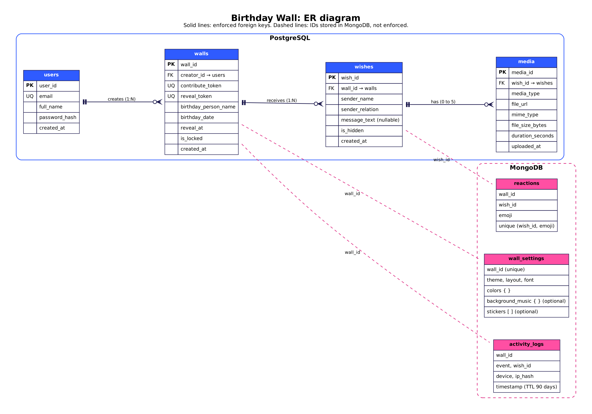
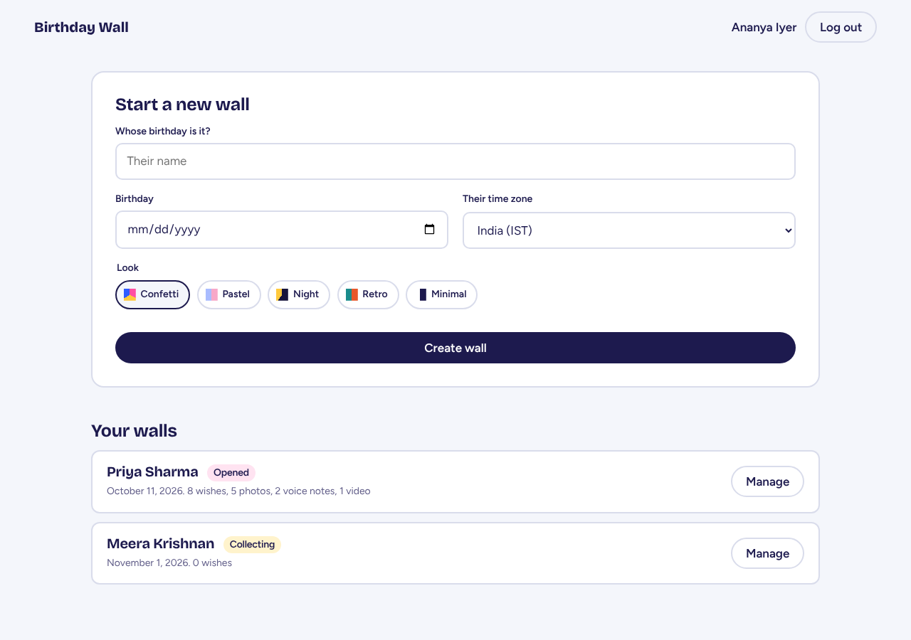
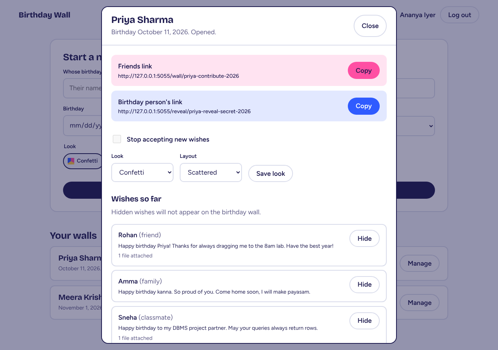
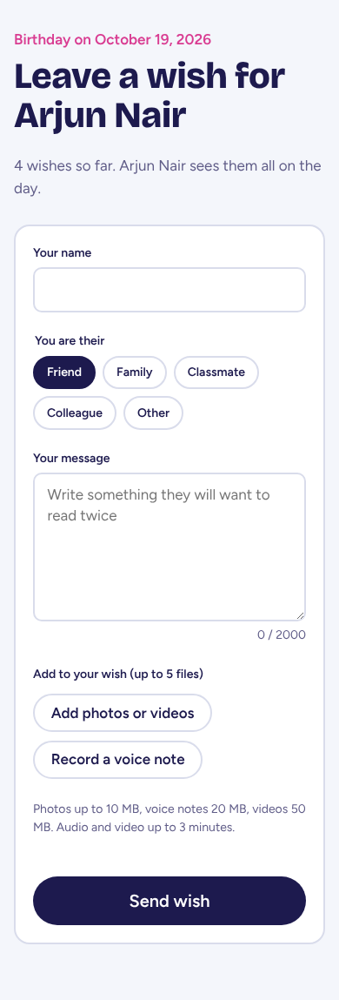
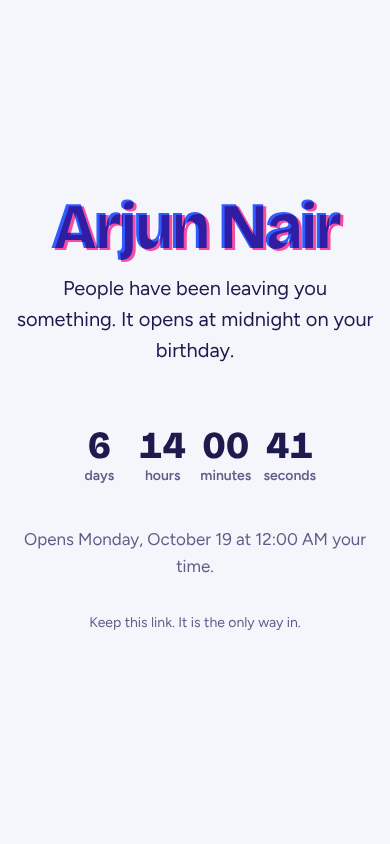

# Birthday Wall
### DBMS Course Project Report

**Team:** _(names and roll numbers)_
**Course:** _(course code and name)_
**Instructor:** _(name)_
**Date:** _(submission date)_

---

## 1. Abstract

Birthday Wall is a web application for collecting birthday wishes from a group of
people and revealing them to the birthday person on the day. An organizer creates a
wall and receives two secret links: one for friends and family, who can leave text
messages, photos, voice notes and videos, and one for the birthday person, which shows
a countdown until midnight on their birthday and then opens the full wall.

The project uses **PostgreSQL** for all structured, transactional data (accounts,
walls, wishes and file metadata) and **MongoDB** for flexible and high-volume data
(per-wall theme settings, emoji reactions and an activity log). Business rules are
enforced inside the database through constraints, triggers, views and stored
procedures, so invalid data is rejected even if the application code has a bug.

---

## 2. Problem statement

Group birthday wishes are usually scattered across chat messages, or collected
manually by one person into a video or card. This is slow for the organizer, and the
surprise is often spoiled because the birthday person is in the same group chats.

The system must:

1. Let anyone with a link contribute text, images, audio and video without an account.
2. Keep every wish hidden from the birthday person until a specific moment.
3. Stop accepting wishes once the wall opens.
4. Let the organizer remove inappropriate content before the reveal.
5. Guarantee that a wish is saved completely (text plus all files) or not at all.

---

## 3. Technology stack

| Layer | Technology | Reason |
|-------|------------|--------|
| Relational database | PostgreSQL 16 | Constraints, triggers, deferred constraint triggers, views, PL/pgSQL, JSON aggregation |
| Document database | MongoDB | Schema-flexible documents, TTL indexes, high write throughput |
| Backend | Python 3, Flask | Small, readable; one route per API endpoint |
| DB drivers | psycopg2 (pooled), pymongo | Parameterised queries prevent SQL injection |
| File storage | Cloudinary | Media files are stored outside the database (see 5.1) |
| Frontend | HTML, CSS, JavaScript | No framework, served by Flask |
| Testing | pytest, mongomock | 34 API tests against a real PostgreSQL instance |

---

## 4. System architecture

```
                 ┌──────────────────────── Browser ────────────────────────┐
                 │  Organizer page    Contribute page    Countdown / Wall  │
                 └──────────┬─────────────────┬──────────────────┬─────────┘
                            │ JSON / multipart over HTTPS        │
                 ┌──────────▼─────────────────▼──────────────────▼─────────┐
                 │                     Flask backend                       │
                 │  auth   walls   wishes   reveal   reactions             │
                 └──────┬──────────────────┬────────────────────┬──────────┘
                        │ SQL (psycopg2)   │ files              │ documents (pymongo)
                 ┌──────▼──────┐    ┌──────▼──────┐      ┌──────▼──────┐
                 │ PostgreSQL  │    │ Cloudinary  │      │   MongoDB   │
                 │ users walls │    │ images      │      │ settings    │
                 │ wishes media│    │ audio video │      │ reactions   │
                 └─────────────┘    └─────────────┘      │ logs        │
                                                         └─────────────┘
```

Three kinds of user are authorised in three different ways:

| User | Authorisation |
|------|---------------|
| Organizer | Email and password; signed session cookie |
| Contributor | Possession of the wall's `contribute_token` (in the link) |
| Birthday person | Possession of the wall's `reveal_token` (in the link) |

---

## 5. Database design

### 5.1 Key design decisions

**Files are not stored in the database.** Storing media as BLOBs would make the
database grow by tens of megabytes per wish, slow down backups and every query that
touches the `media` table, and quickly exceed free hosting limits. Files go to
Cloudinary; the database stores the HTTPS URL plus metadata (type, MIME type, size,
duration) that the application needs for validation and display.

**Media is a separate table.** A wish can carry zero to five files. Columns such as
`image_url, audio_url, video_url` on `wishes` would be mostly NULL and could not
represent two photos on one wish (a repeating group, violating 1NF).

**Contributors have no accounts.** `sender_name` is free text on `wishes`. Requiring
sign-up would drastically reduce participation, and a contributor has no data to
manage after posting.

**Two random tokens per wall.** Sequential IDs in URLs (`/wall/5`) are guessable.
Each wall gets two 32-character random tokens generated by a column `DEFAULT`, with
UNIQUE constraints and a CHECK that they differ.

### 5.2 ER diagram



| Relationship | Cardinality | Participation |
|--------------|-------------|---------------|
| users creates walls | 1 : N | A wall must have a creator; a user may have no walls |
| walls receives wishes | 1 : N | A wish must belong to a wall; a wall may be empty |
| wishes has media | 1 : 0..5 | A file must belong to a wish; a wish may have none |

### 5.3 Relational schema

```
users  (user_id PK, full_name, email UNIQUE, password_hash, created_at)
walls  (wall_id PK, creator_id FK→users, birthday_person_name, birthday_date,
        reveal_at, contribute_token UNIQUE, reveal_token UNIQUE, is_locked, created_at)
wishes (wish_id PK, wall_id FK→walls, sender_name, sender_relation,
        message_text NULL, is_hidden, created_at)
media  (media_id PK, wish_id FK→wishes, media_type, file_url, mime_type,
        file_size_bytes, duration_seconds NULL, uploaded_at)
```

All foreign keys use `ON DELETE CASCADE`: deleting an organizer removes their walls,
which removes their wishes, which removes their media rows.

### 5.4 Normalization

**Functional dependencies**

| Table | Dependencies |
|-------|--------------|
| users | user_id → all; email → all |
| walls | wall_id → all; contribute_token → all; reveal_token → all |
| wishes | wish_id → all |
| media | media_id → all; mime_type → media_type |

**1NF.** All attributes are atomic. Multiple files per wish are stored as rows in
`media`, not as repeated columns or arrays.

**2NF.** Every table has a single-column primary key, so partial dependencies are
impossible.

**3NF / BCNF.** In `users` and `walls`, every determinant (`email`, both tokens) is a
candidate key, so both tables are in BCNF. `wishes` has only the primary key as a
determinant.

**A deliberate exception in `media`.** `mime_type → media_type` (for example,
`image/jpeg` always implies `image`), so `media_type` is transitively dependent on
the key through `mime_type`. Strictly, this breaks 3NF. We keep it because
`media_type` is used in almost every query, CHECK constraint and trigger (size limits
and duration rules differ per type), and deriving it with string functions each time
would make those rules harder to read and to index. The redundancy cannot cause
anomalies because the CHECK constraint `ck_media_mime_matches_type` guarantees the two
columns always agree.

Similarly, `reveal_at` is computed from `birthday_date` and the birthday person's
timezone. Because the timezone is not stored, this is not a functional dependency
within the table, and storing `reveal_at` directly avoids recomputing it on every
request.

### 5.5 Integrity constraints

Twenty named constraints in `02_constraints.sql`, in addition to primary keys and
NOT NULL:

| Constraint | Rule |
|------------|------|
| `uq_users_email`, `ck_users_email_format` | One account per email; valid email pattern (regex) |
| `fk_walls_creator` | Wall belongs to an existing user |
| `uq_walls_contribute_token`, `uq_walls_reveal_token` | Tokens are unique |
| `ck_walls_token_length`, `ck_walls_tokens_differ` | Tokens at least 16 characters and different from each other |
| `ck_walls_reveal_after_creation` | Wall cannot open before it is created |
| `ck_wishes_relation` | Relation is one of five allowed values |
| `ck_wishes_message_length` | Message, if present, is 1 to 2000 non-blank characters |
| `ck_media_type`, `ck_media_mime_matches_type` | Only image/audio/video; MIME type matches |
| `ck_media_file_size` | Image ≤ 10 MB, audio ≤ 20 MB, video ≤ 50 MB |
| `ck_media_duration` | No duration for images; audio/video ≤ 180 seconds |
| `ck_media_url_https` | File URLs must use HTTPS |

Constraints are named so the backend can translate a violation such as
`ck_media_file_size` into the message "File is too large".

### 5.6 Indexes

PostgreSQL indexes primary keys and UNIQUE columns automatically but not foreign
keys. `03_indexes.sql` adds:

| Index | Supports |
|-------|----------|
| `idx_walls_creator_id` | Organizer dashboard: walls by creator |
| `idx_wishes_wall_created (wall_id, created_at)` | Loading a wall's wishes already sorted |
| `idx_media_wish_id` | Fetching files for a set of wishes |
| `idx_walls_open_reveal_at` *partial*, `WHERE is_locked = FALSE` | Job that locks expired walls |
| `idx_wishes_visible` *partial*, `WHERE is_hidden = FALSE` | Reveal page, which never shows hidden wishes |

### 5.7 Triggers

| Trigger | Timing | Rule | Why a CHECK cannot do it |
|---------|--------|------|--------------------------|
| `trg_wishes_wall_open` | BEFORE INSERT on wishes | Reject if wall locked or already revealed | Needs data from `walls` and the current time |
| `trg_media_wall_open` | BEFORE INSERT on media | Same rule for files | Needs a join through `wishes` to `walls` |
| `trg_media_limit` | BEFORE INSERT on media | At most 5 files per wish | Needs a count of other rows |
| `trg_wishes_require_content` | AFTER INSERT on wishes, **DEFERRABLE INITIALLY DEFERRED** | Wish has text or at least one file | Files are inserted after the wish; check must wait until COMMIT |
| `trg_walls_protect_tokens` | BEFORE UPDATE on walls | Tokens and creator cannot change | Needs to compare OLD and NEW values |

**The deferred constraint trigger** is the most interesting. The application inserts
a wish first (to obtain its `wish_id`) and then its files. An ordinary trigger would
reject a voice-note-only wish immediately, before its file row exists. Declaring the
trigger `DEFERRABLE INITIALLY DEFERRED` postpones the check to COMMIT, when the whole
wish is present. An empty wish causes the entire transaction to roll back.

### 5.8 Views

| View | Purpose |
|------|---------|
| `v_wall_summary` | One row per wall with status and counts, using LEFT JOINs, `COUNT(DISTINCT)` and `FILTER` |
| `v_revealed_wishes` | Visible wishes of walls whose `reveal_at` has passed |
| `v_wish_media` | Each wish with its files aggregated into a JSON array (`json_agg`) |
| `v_open_walls` | Walls still accepting wishes; deliberately omits `reveal_token` |

`v_revealed_wishes` is a security boundary: the reveal endpoint reads through it, so
wishes cannot be shown early even if the application forgets to check the date.

### 5.9 Stored procedures and functions

| Routine | Type | Purpose |
|---------|------|---------|
| `sp_submit_wish(token, name, relation, text, media JSONB)` | Procedure | Resolves the token, inserts the wish and every file in one transaction |
| `fn_get_reveal_wall(token)` | Function | Returns wishes with media, or raises `NOT_YET_REVEALED` with the reveal time |
| `fn_wall_stats(wall_id)` | Function | Counts, unique senders, storage, first/last wish, most common relation |
| `fn_lock_expired_walls()` | Function | Locks walls past their reveal time; returns how many changed |

### 5.10 Transactions and concurrency

**Atomicity.** `sp_submit_wish` runs inside a single transaction. If the third of
four files violates `ck_media_file_size`, PostgreSQL rolls back the wish and the first
two files. Test `procedure rolls back wish if a file is invalid` demonstrates this.
On the application side, if the database rejects a wish after files were uploaded to
Cloudinary, the backend deletes those files (compensating action).

**Race condition on the file limit.** Two uploads for the same wish arriving
simultaneously could each count four existing files and both succeed, leaving six.
`trg_media_limit` first runs `SELECT ... FOR UPDATE` on the parent wish row, so the
second transaction waits for the first to commit and then sees the correct count.

**Connection handling.** The backend uses a connection pool; each
`with get_cursor():` block is exactly one transaction that commits on success and
rolls back on any exception.

---

## 6. NoSQL design (MongoDB)

### 6.1 Collections

| Collection | Example document | Indexes |
|------------|------------------|---------|
| `wall_settings` | `{wall_id, theme, layout, font, colors{}, background_music{}, stickers[]}` | unique `wall_id` |
| `reactions` | `{wall_id, wish_id, emoji, created_at}` | unique `(wish_id, emoji)`; `wall_id` |
| `activity_logs` | `{wall_id, event, wish_id, device, ip_hash, timestamp}` | `(wall_id, timestamp)`; TTL 90 days on `timestamp` |

Each collection has a `$jsonSchema` validator (MongoDB's equivalent of CHECK
constraints) restricting required fields, enums and formats. IP addresses are stored
only as truncated SHA-256 hashes.

### 6.2 Why two databases

| Data | Characteristics | Better fit |
|------|-----------------|------------|
| Accounts, walls, wishes, file metadata | Relationships, strict rules, must be atomic | PostgreSQL |
| Theme settings | Shape varies per wall; optional nested fields | MongoDB |
| Reactions | Small, frequent writes; one simple uniqueness rule | MongoDB |
| Activity logs | Append-only, grows fastest, should expire automatically | MongoDB (TTL index) |

PostgreSQL's JSONB could store the same documents. We separate them to keep the
transactional database small and focused, and to use MongoDB features (TTL expiry,
schema-per-document) that suit logs and preferences. We acknowledge this is a
trade-off rather than a necessity at this scale.

### 6.3 Consistency across databases

There are no foreign keys or shared transactions between PostgreSQL and MongoDB. The
application handles this explicitly:

* **Before writing a reaction,** it confirms in PostgreSQL (through
  `v_revealed_wishes`) that the wish exists, is visible and has been revealed.
* **When a wall is deleted,** PostgreSQL deletes first (cascading). Only after that
  commits does the backend delete the wall's MongoDB documents.
* **Logging never blocks a request.** If MongoDB is unavailable, the wish is still
  saved and only the log entry is lost. Nothing critical lives in MongoDB.

---

## 7. Sample queries

`database/postgres/08_queries.sql` contains twelve queries, each demonstrating a
different concept. Selected examples:

**Window function: rank contributors per wall**
```sql
SELECT wall_id, sender_name, wishes_sent, files_sent,
       RANK() OVER (PARTITION BY wall_id ORDER BY wishes_sent + files_sent DESC) AS rank
FROM (
    SELECT ws.wall_id, ws.sender_name,
           COUNT(DISTINCT ws.wish_id) AS wishes_sent, COUNT(m.media_id) AS files_sent
    FROM wishes ws LEFT JOIN media m ON m.wish_id = ws.wish_id
    GROUP BY ws.wall_id, ws.sender_name
) t;
```

**Correlated subquery: messages longer than their wall's average**
```sql
SELECT ws.wall_id, ws.sender_name, length(ws.message_text) AS msg_length
FROM wishes ws
WHERE ws.message_text IS NOT NULL
  AND length(ws.message_text) > (SELECT AVG(length(x.message_text))
                                 FROM wishes x
                                 WHERE x.wall_id = ws.wall_id AND x.message_text IS NOT NULL);
```

**MongoDB aggregation: reactions per emoji on a wall**
```js
db.reactions.aggregate([
  { $match: { wall_id: 1 } },
  { $group: { _id: "$emoji", count: { $sum: 1 } } },
  { $sort: { count: -1 } }
])
```

Other queries cover INNER and LEFT JOIN, GROUP BY with HAVING, three-table
aggregation, CTEs, CASE, EXISTS and date functions.

---

## 8. Application

### 8.1 API

| Method and path | Who | Database operation |
|-----------------|-----|--------------------|
| `POST /api/walls` | Organizer | INSERT walls; insert settings document |
| `GET /api/walls` | Organizer | `v_wall_summary` |
| `PATCH /api/walls/<id>/wishes/<wish_id>` | Organizer | UPDATE `is_hidden` |
| `DELETE /api/walls/<id>` | Organizer | DELETE (cascade) + MongoDB cleanup |
| `GET /api/contribute/<token>` | Contributor | SELECT by `contribute_token` |
| `POST /api/contribute/<token>/wishes` | Contributor | `CALL sp_submit_wish` |
| `GET /api/reveal/<token>` | Birthday person | `fn_get_reveal_wall`, `fn_wall_stats` |
| `POST /api/reveal/<token>/wishes/<id>/reactions` | Birthday person | `v_revealed_wishes` check + MongoDB insert |

Full reference: `docs/api.md`.

### 8.2 Pages

| Page | Function |
|------|----------|
| Home | Log in or register; create walls; manage links, lock, theme, hide wishes, delete |
| Contribute | Name, relation, message, file upload, in-browser voice recording, upload progress |
| Countdown | Shown before the reveal; the server never sends the wishes page early |
| Wall | All visible wishes with photos, audio, video, and emoji reactions; five themes, three layouts |

| | |
|---|---|
|  |  |
|  |  |
|  |  |

_(Screenshots use seed data with placeholder photos. Retake them with your own data before submitting.)_

### 8.3 Security measures

* Passwords hashed with scrypt (Werkzeug); never stored or logged in plain text.
* All SQL uses parameterised queries; no string concatenation.
* Session cookie is HttpOnly, SameSite=Lax, and Secure in production.
* Organizers can only access walls where `creator_id` matches; other walls return 404,
  not 403, so wall IDs cannot be enumerated.
* Reveal time is enforced in the database (`fn_get_reveal_wall`, `v_revealed_wishes`)
  and again when choosing which page to render.
* All user text is HTML-escaped before display.

---

## 9. Testing

| Suite | Count | What it proves |
|-------|-------|----------------|
| `database/postgres/09_tests.sql` | 29 | Every constraint and trigger rejects invalid data; rollback leaves no orphan rows; cascade delete works |
| `tests/test_api.py` | 34 | Every endpoint, permissions between organizers, closed walls, file limits, upload cleanup on database rejection, timezone-correct reveal time, MongoDB cleanup |

Both suites run against a real PostgreSQL 16 instance. MongoDB is simulated with
mongomock in the API tests; Cloudinary is replaced by a fake that records uploads and
deletions.

---

## 10. Limitations and future work

| Limitation | Possible improvement |
|------------|----------------------|
| No rate limiting on contribute links | Flask-Limiter, or a per-IP counter in MongoDB |
| Deleting a wall leaves its files in Cloudinary | Store Cloudinary `public_id` in `media` and delete files in the same flow |
| File type trusted from the browser's MIME header | Inspect file bytes, or rely on Cloudinary's detected format |
| No email verification or password reset | Signed, expiring tokens sent by email |
| Birthday timezone not stored | Add a `timezone` column so `reveal_at` can be recomputed if the date changes |
| `media_type` is redundant with `mime_type` | Acceptable trade-off (5.4); could become a generated column |

---

## 11. Conclusion

The project shows how database features can carry most of an application's business
logic. Constraints, triggers (including a deferred constraint trigger), views and a
transactional procedure guarantee that wishes are complete, appear only on open walls,
respect file limits and stay hidden until the birthday, independent of the
application layer. MongoDB complements PostgreSQL for data that is flexible in shape
or high in volume, and the project explicitly handles the consistency gap that comes
with using two databases.

---

## Appendix: file reference

| File | Contents |
|------|----------|
| `database/postgres/01_schema.sql` | Tables |
| `database/postgres/02_constraints.sql` | Named constraints |
| `database/postgres/03_indexes.sql` | Indexes |
| `database/postgres/04_triggers.sql` | Triggers |
| `database/postgres/05_views.sql` | Views |
| `database/postgres/06_functions.sql` | Procedure and functions |
| `database/postgres/07_seed_data.sql` | Demo data |
| `database/postgres/08_queries.sql` | Report queries |
| `database/postgres/09_tests.sql` | Database tests |
| `database/mongo/collections.md` | MongoDB design |
| `database/mongo/seed_mongo.py` | MongoDB setup and demo data |
| `docs/er_diagram.dot` / `.png` | ER diagram source and image |
| `docs/api.md` | API reference |
